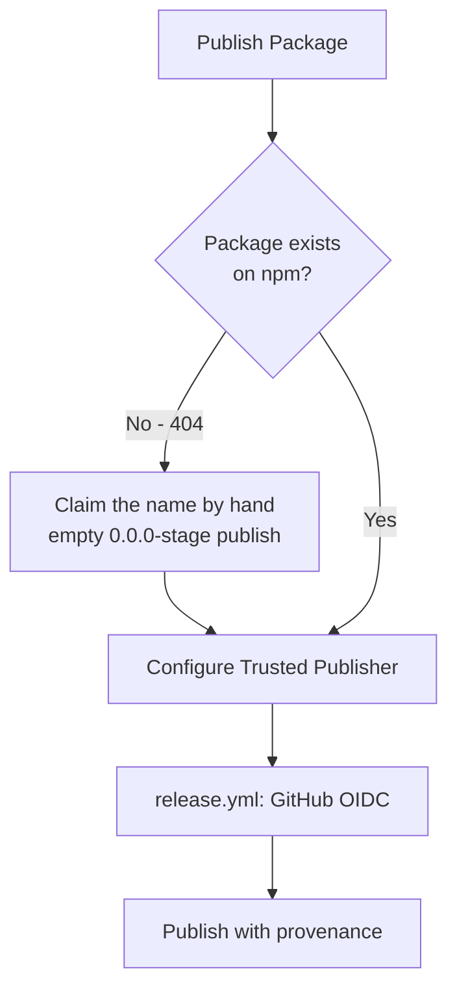

# NPM Authentication Strategy

> **📚 Part of [CI/CD Pipeline Documentation](../CICD_PIPELINE.md)**
>
> Related docs: [Failure Scenarios](./FAILURE_SCENARIOS.md) • [Trusted Publishing setup](../TRUSTED_PUBLISHING_SETUP.md)

---

## One method: npm Trusted Publishers (OIDC)

Every package, scoped (`@interlace/*`) or unscoped (`eslint-plugin-*`, `oxlint-plugin-*`), publishes through Trusted
Publishing. There is no long-lived npm token in CI. The `NPM_TOKEN` first-release fallback and the
`npm-token-health.yml` check that watched it were removed in #1213.

| Aspect         | Value                                        |
| -------------- | -------------------------------------------- |
| **Security**   | ✅ No secrets - uses GitHub OIDC             |
| **Provenance** | ✅ Cryptographic attestation of build origin |
| **Setup**      | One-time configuration per package           |

### Setup Steps

1. Go to: `npmjs.com` → Package → Settings → Trusted Publisher
2. Select: GitHub Actions
3. Configure:

| Field           | Value                           |
| --------------- | ------------------------------- |
| **Repository**  | `ofri-peretz/eslint`            |
| **Workflow**    | `.github/workflows/release.yml` |
| **Environment** | `production`                    |

---

## First Release Flow

**OIDC Trusted Publishers cannot create new packages on npm.** A Trusted Publisher can only be configured on a package
that already exists, so a new package name is claimed by hand before `release.yml` ever publishes it:

1. Publish an empty `0.0.0-stage` by hand. `scripts/reconcile-tags.ts` ignores `0.0.0-*` versions.
2. Configure the package's Trusted Publisher (above).
3. Merge the Version Packages PR; `release.yml` publishes the first real version and tags it.

If step 1 or 2 is skipped, `release.yml`'s detect step logs `not on npm yet` and the publish job for that package fails
with `E404 PUT`; its siblings still publish (`fail-fast: false`), and `release-liveness.yml` reports the package as
behind npm until it ships.

---

## Security Features

| Feature                       | Status                         | Notes                         |
| ----------------------------- | ------------------------------ | ----------------------------- |
| NPM Trusted Publishers (OIDC) | ✅ Only method                 | Every package                 |
| `id-token: write` permission  | ✅ Configured                  | Required for OIDC/provenance  |
| `environment: production`     | ✅ Configured                  | GitHub environment protection |
| `NPM_CONFIG_PROVENANCE: true` | ✅ Enabled                     | npm provenance attestation    |
| Concurrency locking           | ✅ `cancel-in-progress: false` | Queue concurrent releases     |

---

## Quick Fix Reference

| Problem                          | Solution                                                    |
| -------------------------------- | ----------------------------------------------------------- |
| **`E404 PUT` / 401 / 403**       | Configure (or fix) the package's Trusted Publisher, re-run |
| **Package not on npm at all**    | Claim the name by hand, then configure Trusted Publisher    |
| **Network Error**                | Check https://status.npmjs.org/, re-run workflow            |

---

> **[← Back to Main CI/CD Documentation](../CICD_PIPELINE.md)**
