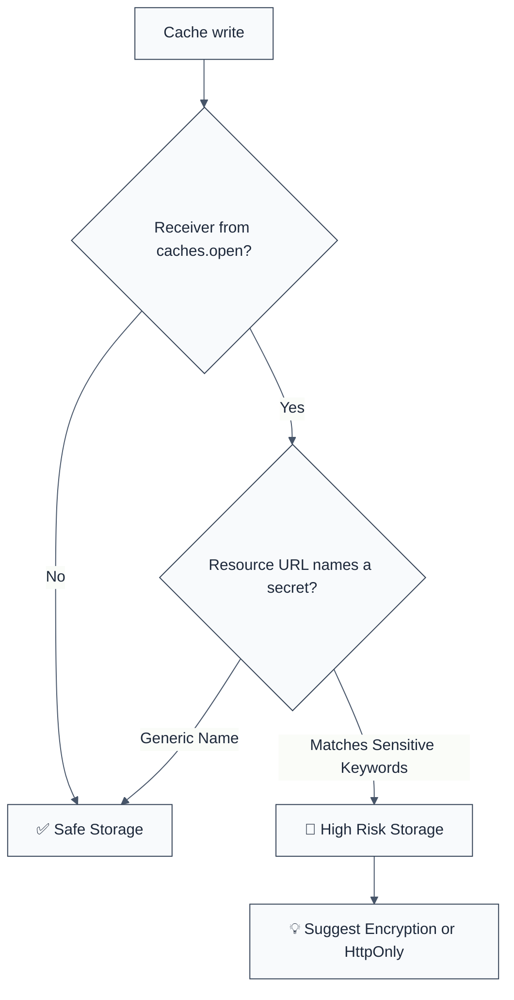

import { FalseNegativeCTA, WhenNotToUse, RuleBadges } from "@/components/RuleComponents";

<RuleBadges typeAware={false} typeAwareStatus="unaware" />

## Quick Summary

| Aspect          | Details                                 |
| --------------- | --------------------------------------- |
| **Severity**    | High (Information Disclosure)           |
| **Auto-Fix**    | ❌ No (requires architectural update)   |
| **Category**   | Security |
| **ESLint MCP**  | ✅ Optimized for ESLint MCP integration |
| **Best For**    | Apps handling PII or auth tokens        |
| **Suggestions** | ✅ Advice on using session-only storage |

## Vulnerability and Risk

**Vulnerability:** Information disclosure occurs when sensitive data (like passwords, tokens, or PII) is stored in browser-accessible storage like `localStorage`, `sessionStorage`, or the `Cache` API.

**Risk:** Data in these storages is often persistent and lacks high-fidelity access control. It can be easily accessed by malicious scripts (Cross-Site Scripting - XSS) or anyone with physical access to the device.

## Error Message Format

The rule provides **LLM-optimized error messages** (Compact 2-line format) with actionable security guidance:

```text
🔒 CWE-200 OWASP:M9 | Sensitive Data in Cache detected | HIGH [InfoDisclosure,Privacy]
   Fix: Do not store sensitive data in browser caches; use HttpOnly cookies | https://cwe.mitre.org/data/definitions/200.html
```

### Message Components

| Component                 | Purpose                | Example                                                                                                             |
| :------------------------ | :--------------------- | :------------------------------------------------------------------------------------------------------------------ |
| **Risk Standards**        | Security benchmarks    | [CWE-200](https://cwe.mitre.org/data/definitions/200.html) [OWASP:M9](https://owasp.org/www-project-mobile-top-10/) |
| **Issue Description**     | Specific vulnerability | `Sensitive Data in Cache detected`                                                                                  |
| **Severity & Compliance** | Impact assessment      | `HIGH [InfoDisclosure,Privacy]`                                                                                     |
| **Fix Instruction**       | Actionable remediation | `Do not store sensitive data in browser caches`                                                                     |
| **Technical Truth**       | Official reference     | [Exposure of Sensitive Info](https://cwe.mitre.org/data/definitions/200.html)                                       |

## Rule Details

This rule flags writes to the browser's **Cache Storage API** — `put`, `add` and `addAll` on a `Cache` the file proves came from `caches.open(…)` (awaited, through `.then(cache => …)`, or a `const` bound to either) — whose cached resource URL names a credential or a regulated identifier. The URL is read from a string, a `const` bound to one, `new Request('/url')` or `new URL('/url', base)` (Cache keys a URL object by the request it names), and matched as whole words: `password`, `token`, `secret`, `api key`, `credit card`, `ssn`, and the rest of the shared secret vocabulary.

A free `cache` object of unknown type is **not** the Cache API: `cacheMap.set('creditLimit', 5000)`, an LRU's `.set`, a Redux `store.put(…)` and a memoizer's `.store` were all reported before the rule proved its receiver, and none of them is a browser cache. Sensitive values in Web Storage, IndexedDB or cookies belong to [`no-sensitive-localstorage`](./no-sensitive-localstorage), [`no-sensitive-sessionstorage`](./no-sensitive-sessionstorage), [`no-jwt-in-storage`](./no-jwt-in-storage) and [`no-sensitive-indexeddb`](./no-sensitive-indexeddb).




### Why This Matters

| Issue              | Impact                         | Solution                                      |
| ------------------ | ------------------------------ | --------------------------------------------- |
| 🕵️ **XSS Impact**  | Tokens stolen via script       | Store tokens in HttpOnly/Secure cookies       |
| 🗄️ **Persistence** | Data stays on public computers | Use session-only variables for sensitive data |
| 🤝 **Trust**       | User data leaked               | Encrypt any mandatory client-side storage     |

## Configuration

See [Options](#️-options).

## Examples

### ❌ Incorrect

```javascript
const cache = await caches.open('v1');
cache.put('/api/token', tokenResponse);
cache.put(new Request('/account/password'), response);
cache.add(new URL('/api/token', location.origin));

caches.open('v1').then((c) => c.addAll(['/api/ssn-lookup', '/app.js']));
```

### ✅ Correct

```javascript
// Cache static assets only
const cache = await caches.open('v1');
cache.addAll(['/app.js', '/styles.css']);

// Not the Cache API: an application map or LRU is out of scope
const lru = new Map();
lru.set('token', value);

// Store non-sensitive identifiers instead
localStorage.setItem('user_preferences', JSON.stringify({ theme: 'dark' }));

// For authentication tokens, use HttpOnly cookies (handled on the server)
// Or use short-lived in-memory variables.

// If storage is absolutely necessary, encrypt the data before storing
const encryptedData = encryptSensitiveData(token);
localStorage.setItem('auth_token_encrypted', encryptedData);
```

<WhenNotToUse />

<FalseNegativeCTA />

## Known False Negatives

The following patterns are **not detected** due to static analysis limitations:

### Non-Literal Keys

**Why**: If the storage key is constructed dynamically or passed as a variable, this rule might miss it as it specifically checks literal strings.

```javascript
const KEY_NAME = 'auth_token';
localStorage.setItem(KEY_NAME, data); // ❌ NOT DETECTED
```

**Mitigation**: Standardize storage keys throughout the application and use a centralized storage wrapper.

### Obfuscated Key Names

**Why**: Developers might use non-obvious key names to store sensitive data.

```javascript
localStorage.setItem('xyz123', secret_token); // ❌ NOT DETECTED
```

**Mitigation**: Perform thorough code reviews and use data masking or encryption.

## References

- [CWE-200: Exposure of Sensitive Information](https://cwe.mitre.org/data/definitions/200.html)
- [OWASP HTML5 Security Cheat Sheet - Local Storage](https://cheatsheetseries.owasp.org/cheatsheets/HTML5_Security_Cheat_Sheet.html#local-storage)
- [MDN - Window.localStorage](https://developer.mozilla.org/en-US/docs/Web/API/Window/localStorage)

## ⚙️ Options

| Option | Type | Default | Description |
| ------ | ---- | ------- | ----------- |
| `allowInTests` | `boolean` | `true` | Skip this rule in `*.test.*` / `*.spec.*` files |