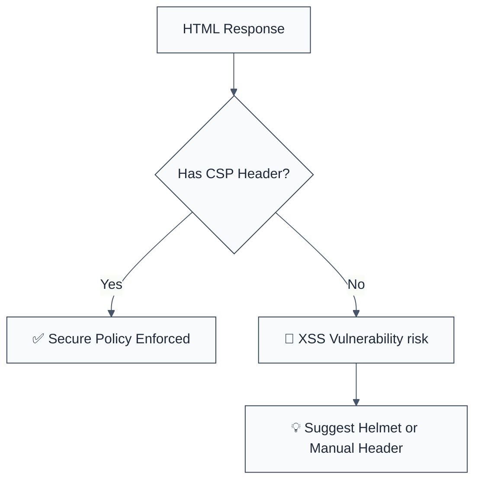

import { FalseNegativeCTA, WhenNotToUse, RuleBadges } from "@/components/RuleComponents";

<RuleBadges typeAware={false} typeAwareStatus="unaware" />

## Quick Summary

| Aspect          | Details                                         |
| --------------- | ----------------------------------------------- |
| **Severity**    | Medium (XSS Mitigation)                         |
| **Auto-Fix**    | ❌ No (requires policy definition)              |
| **Category**    | Security                                        |
| **ESLint MCP**  | ✅ Optimized for ESLint MCP integration         |
| **Best For**    | Web servers serving HTML content                |
| **Suggestions** | ✅ Advice on using Helmet for standard policies |

## Vulnerability and Risk

**Vulnerability:** A missing or weak Content Security Policy (CSP) leaves an application vulnerable to Cross-Site Scripting (XSS), clickjacking, and data injection attacks.

**Risk:** Without a CSP, the browser has no way of knowing if a script running on the page is legitimate or has been injected by an attacker. A successful XSS attack can lead to session theft, credential harvesting, and defacement.

## Error Message Format

The rule provides **LLM-optimized error messages** (Compact 2-line format) with actionable security guidance:

```text
🔒 CWE-1021 OWASP:M8 | Missing CSP detected | MEDIUM [XSS Mitigation]
   Fix: Use helmet.contentSecurityPolicy() or set CSP header manually | https://cwe.mitre.org/data/definitions/1021.html
```

### Message Components

| Component                 | Purpose                | Example                                                                                                               |
| :------------------------ | :--------------------- | :-------------------------------------------------------------------------------------------------------------------- |
| **Risk Standards**        | Security benchmarks    | [CWE-1021](https://cwe.mitre.org/data/definitions/1021.html) [OWASP:M8](https://owasp.org/www-project-mobile-top-10/) |
| **Issue Description**     | Specific vulnerability | `Missing CSP detected`                                                                                                |
| **Severity & Compliance** | Impact assessment      | `MEDIUM [XSS Mitigation]`                                                                                             |
| **Fix Instruction**       | Actionable remediation | `Use helmet.contentSecurityPolicy()`                                                                                  |
| **Technical Truth**       | Official reference     | [Improper Restriction](https://cwe.mitre.org/data/definitions/1021.html)                                              |

## Rule Details

This rule flags an Express response that emits an HTML **document** without a Content-Security-Policy being configured:

- `res.send(…)` / `res.write(…)` / `res.end(…)` whose body is a document — a doctype or an `<html>` tag, including a page accumulated across statements;
- `<response>.render(view)`, where the receiver is one of `responseReceivers` (template engines' own `render` returns a string and is not a response);
- `res.sendFile(…)` of an `.html` / `.htm` file.

A markup **fragment** (`res.send('<div>…</div>')`) is not reported: it is a partial for a page whose policy was set by whatever served that page. JSON and plain-text bodies are not documents.

A policy counts as configured when the file establishes one anywhere:

- helmet **applied** with CSP on — `app.use(helmet())`, `helmet({ contentSecurityPolicy: { … } })`, `helmet.contentSecurityPolicy(…)`, `import { contentSecurityPolicy } from 'helmet'`. Importing helmet without calling it, `helmet({ contentSecurityPolicy: false })` (helmet's switch for turning CSP off), and other helmet middleware such as `helmet.frameguard()` do **not** count;
- the `Content-Security-Policy` header name in a header-setting position (`res.setHeader`, `res.set`, `res.header`, `res.writeHead`, a `headers` object, a Next.js `{ key, value }` entry);
- a `<meta httpEquiv="Content-Security-Policy">`.

Setting **other** headers (`X-Frame-Options`, `X-Content-Type-Options`) is not a policy, and the response is still reported. (That case used to be left to `no-missing-security-headers`, which is deprecated; enabling it explicitly adds its broader finding beside this one.)




### Why This Matters

| Issue               | Impact                          | Solution                                        |
| ------------------- | ------------------------------- | ----------------------------------------------- |
| 🕵️ **XSS**          | Session theft and data leakage  | Define strict `script-src` and `object-src`     |
| 🚀 **Exfiltration** | Stealing data to external sites | Use `connect-src` to restrict outgoing requests |
| 🤝 **Trust**        | Site used for phishing          | Use `frame-ancestors` to prevent clickjacking   |

## Options

| Option              | Type       | Default                      | Description                                                                                                                                                           |
| ------------------- | ---------- | ---------------------------- | --------------------------------------------------------------------------------------------------------------------------------------------------------------------- |
| `responseReceivers` | `string[]` | `["res","response","reply"]` | Identifiers that name a response object, so `<name>.render(view)` emits a response rather than returning a string. Anything unlisted is treated as a template engine. |

`<name>.render(view)` is only a response emission when `<name>` is a response
object. `nunjucksEnv.render(template, data)` returns a string, and so do
mustache, ejs, handlebars and ReactDOMServer — none of them can set an HTTP
header, so demanding a CSP at those call sites is a finding nobody can action.

Setting this **replaces** the default list rather than extending it, so a
codebase whose handlers name the response something else lists every name it
uses:

```json
{
  "rules": {
    "browser-security/require-csp-headers": [
      "error",
      { "responseReceivers": ["res", "response", "reply", "httpRes"] }
    ]
  }
}
```

The rule also skips test files: rendering a template to assert on its markup is
not a route serving a document.

## Examples

### ❌ Incorrect

```javascript
// Sending HTML directly without CSP headers
app.get('/', (req, res) => {
  res.send('<!DOCTYPE html><html><body><h1>Hello World</h1></body></html>');
});

// Rendering a view without global CSP middleware
app.get('/home', (req, res) => {
  res.render('index', { title: 'Home' });
});

// helmet imported but never applied, or applied with CSP switched off
import helmet from 'helmet';
app.use(helmet({ contentSecurityPolicy: false }));

// Some security header, but no policy
app.get('/', (req, res) => {
  res.setHeader('X-Frame-Options', 'DENY');
  res.render('index');
});
```

### ✅ Correct

```javascript
app.use(helmet());

app.get('/', (req, res) => {
  res.setHeader('Content-Security-Policy', "default-src 'self'");
  res.render('index');
});

res.send({ data: 'json' });

// A fragment for a page served elsewhere
res.send('<div class="greeting">Hello</div>');
```

<WhenNotToUse />

<FalseNegativeCTA />

## Known False Negatives

The following patterns are **not detected** due to static analysis limitations:

### Global Middleware

**Why**: This rule is a heuristic and analyzes files individually. If you have global middleware like `helmet` in a central `app.js`, individual route handlers might still be flagged.

**Mitigation**: Use `// eslint-disable-next-line` for route handlers in projects where CSP is enforced globally.

### Non-Standard Express Methods

**Why**: Custom response wrappers or other frameworks might use different methods to send HTML.

**Mitigation**: Standardize on a security-first framework and ensure it's applied consistently.

## References

- [MDN - Content Security Policy (CSP)](https://developer.mozilla.org/en-US/docs/Web/HTTP/CSP)
- [CWE-1021: Improper Restriction of Rendered-UI Layers or Frames](https://cwe.mitre.org/data/definitions/1021.html)
- [Helmet.js - CSP](https://helmetjs.github.io/#content-security-policy)
- [OWASP Content Security Policy Cheat Sheet](https://cheatsheetseries.owasp.org/cheatsheets/Content_Security_Policy_Cheat_Sheet.html)